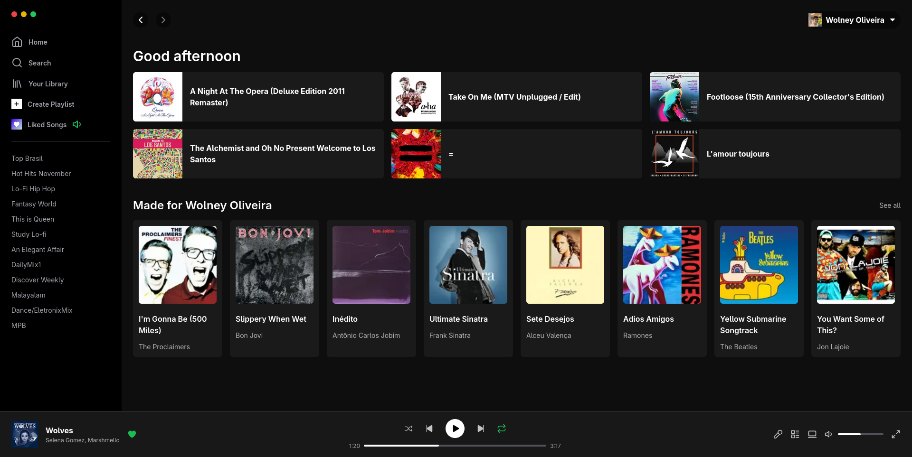

# Spotify Web UI

This project is a web interface clone of [Spotify](https://spotify.com), built to practice and demonstrate front-end development skills using React and modern web technologies. The goal is to recreate the look and feel of Spotify's web player, focusing on UI/UX design and component architecture.

The application features a modern design that closely mimics the original Spotify interface (2023), including a sidebar navigation, main content area, and media player controls. This project serves as a learning exercise to explore advanced React patterns, state management, and styling techniques.

## Screenshots



## Stack

This project is built with the following technologies:

- **[Next.js](https://nextjs.org/)** (13.3.0) - React framework for production with server-side rendering and static site generation
- **[React](https://reactjs.org/)** (18.2.0) - JavaScript library for building user interfaces
- **[TypeScript](https://www.typescriptlang.org/)** (5.0.4) - Typed superset of JavaScript for better developer experience
- **[Tailwind CSS](https://tailwindcss.com/)** (3.3.1) - Utility-first CSS framework for rapid UI development
- **[Radix UI](https://www.radix-ui.com/)** - Unstyled, accessible component primitives
- **[Lucide React](https://lucide.dev/)** - Beautiful & consistent icon toolkit
- **[React Icons](https://react-icons.github.io/react-icons/)** - Popular icons library for React

## Run Locally

To run this project locally, follow these steps:

### Prerequisites

- Node.js (version 18 or higher)
- pnpm (package manager)

### Installation

1. Clone the repository:

```bash
git clone git@github.com:wolney-fo/spotify-web-ui.git
cd spotify-web-ui
```

2. Install dependencies:

```bash
pnpm install
```

### Development

Run the development server:

```bash
pnpm dev
```

Open [http://localhost:3000](http://localhost:3000) in your browser to see the application.

### Build

To create a production build:

```bash
pnpm build
```

To start the production server:

```bash
pnpm start
```

## License

MIT by Wolney Oliveira
